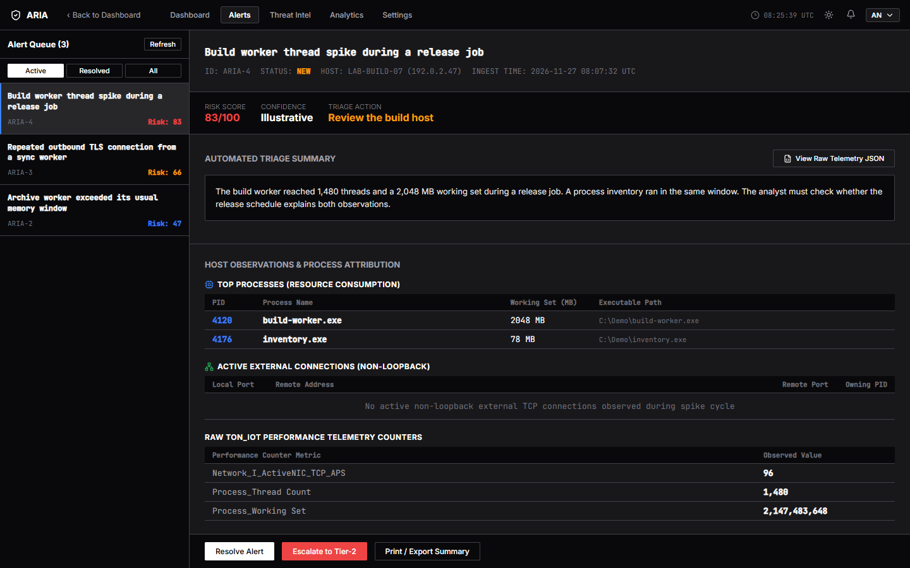
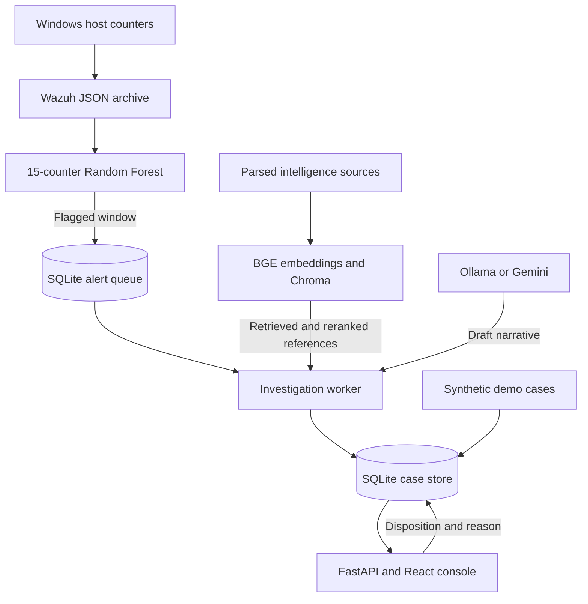

# ARIA

**Automated Retrieval and Investigation Agent for Host Telemetry and SOC Triage**

[](https://github.com/KushalGupta05/ARIA/actions/workflows/ci.yml)

ARIA helps a security analyst decide what to do with a Windows host alert. It brings the triggering counters, running processes, network connections and supporting references into one case. The analyst can inspect the evidence, escalate the case or record why it was closed.



*In this synthetic case, a build worker reached 1,480 threads during a release. The open question is whether the scheduled job explains the spike.*

## Try the console

The demo includes four authored cases, a small technique catalog and a local SQLite database. It runs on Windows, macOS or Linux with Python 3.12 or 3.14 and Node.js 22.12+ or 24. Wazuh, model downloads and API keys are optional research dependencies.

```sh
git clone https://github.com/KushalGupta05/ARIA.git
cd ARIA
python -m venv .venv
```

Activate the environment with `.\.venv\Scripts\Activate.ps1` in PowerShell or `source .venv/bin/activate` on macOS and Linux. In the same terminal run

```sh
python -m pip install -r requirements.txt
npm ci --prefix ARIA-Frontend
npm run build --prefix ARIA-Frontend
python ML_Model/demo.py
```

Open the welcome screen and select **Open analyst console**. The API reference is available on the same server. [Local console](http://127.0.0.1:8000) · [API reference](http://127.0.0.1:8000/docs)

1. Select **Alerts** to open the newest case, **ARIA-4**. Compare the build worker's process ID and working set with the raw telemetry.
2. Select **Resolve Alert**, choose **Benign** and add a reason. The decision survives a page refresh and an application restart.
3. Open **Dashboard → Resolved History** to find the case. Open **Analytics** to see the updated counts.

Stop the server with Ctrl+C. Demo state lives in `var/demo/`. To start another casebook, run `python ML_Model/demo.py --state-dir var/second-demo`. The demo binds to loopback and is intended for a single analyst on their own machine.

## How an alert reaches the analyst



The research pipeline uses a Random Forest for classification and a separate rule-based score for priority. Retrieval supplies references for an investigation narrative. Each demo case already contains its narrative, so the quickstart exercises the analyst workflow without running inference.

## Explore the project

| Area | What to look for |
| --- | --- |
| [Analyst console](ARIA-Frontend/src/pages) | Case queue, process and socket evidence, threat-intelligence search, dispositions and print-ready reports |
| [Analyst API](ML_Model/frontend_api.py) | SQLite-backed alert, settings, analytics and technique endpoints |
| [Classifier and evaluation](docs/classifier.md) | Rebuild the Windows model, inspect the split and per-class results, and connect the collector |
| [Retrieval and generation](ML_Model/RAG_Pipeline/README.md) | Index documents, choose a model provider and run the investigation worker |
| [Synthetic casebook](examples/cases.json) | Inspect the four cases behind the walkthrough |
| [Development checks](CONTRIBUTING.md) | Run the API tests and the browser test used by CI |

## Research result

The included training recipe achieved **0.9864 macro F1 on 4,223 held-out TON_IoT Windows 10 rows**. Scanning recall was 0.8222, and the MITM test slice contained only three examples. These results describe this dataset split. Detection performance on independently labeled live hosts remains unmeasured. [Method, dataset fingerprint and class results](docs/classifier.md)

## Authors

Kushal Gupta and Krish Choudhari developed ARIA as a B.Tech. Information Technology project. This edition brings together the project workspace, including work from the original console and retrieval repositories. [Console repository](https://github.com/Krish8321/ARIA-Frontend) · [Retrieval repository](https://github.com/Krish8321/RAG-pipeline-src-code) · [Citation metadata](CITATION.cff)
